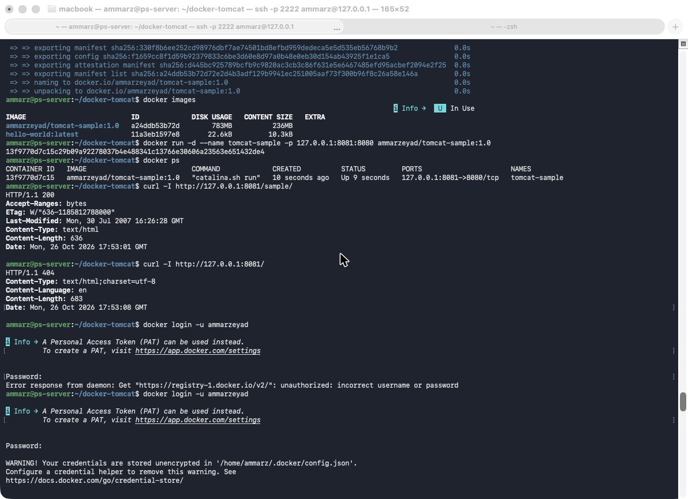
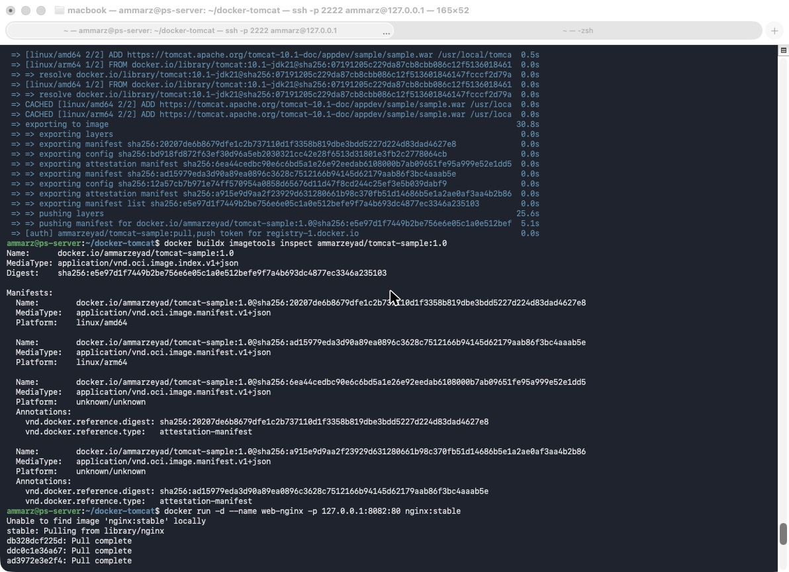
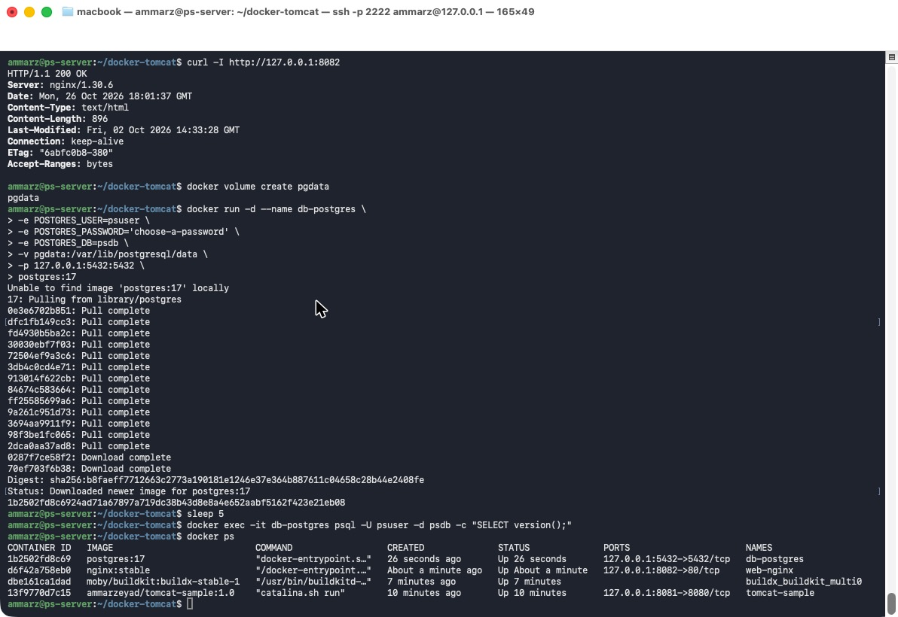

# Docker

| | |
|---|---|
| Server | `ps-server`, Ubuntu 26.04.1 LTS, ARM64 (`aarch64`) |
| Docker | Ubuntu's `docker.io` package, with `docker-buildx` |
| Image on Docker Hub | [`ammarzeyad/tomcat-sample:1.0`](https://hub.docker.com/r/ammarzeyad/tomcat-sample) (linux/amd64 and linux/arm64) |

**Contents**
1. [What is Docker?](#what-is-docker)
2. [Use cases](#use-cases)
3. [Basic commands](#basic-commands)
4. [Install Docker](#d1-install-docker)
5. [Tomcat image with a sample WAR](#d2-tomcat-image-with-a-sample-war)
6. [Push to Docker Hub](#d3-push-to-docker-hub)
7. [Nginx and PostgreSQL containers](#d4-nginx-and-postgresql-containers)

---

## Theory

### What is Docker?
Docker solves the "it works on my machine" problem. It packs an application together with everything it needs to run (system files, a runtime such as Java, libraries and settings) into an **image**. An image is read-only, so it runs the same way on any machine that has Docker.

A **container** is what you get when you run an image: an isolated process on the host. You can start many containers from the same image.

Containers share the host's kernel, so there is no operating system to boot, unlike a virtual machine. That's why a container starts in seconds. The kernel isolates each container with **namespaces** (its own processes, network and files) and limits it with **cgroups** (CPU and memory).

| Term | Meaning |
|---|---|
| Image | read-only package of an app and everything it needs |
| Container | a running image (an isolated process) |
| Dockerfile | the text recipe used to build an image |
| Registry | where images are stored and shared, e.g. Docker Hub (`push`, `pull`) |
| Port publishing | `-p host_port:container_port` opens a container port on the host |
| Volume | storage outside the container, so data survives when the container is removed |

| | Virtual machine | Container |
|---|---|---|
| Own OS kernel | yes | no, shares the host's kernel |
| Start time | about a minute (boots an OS) | seconds (starts a process) |
| Size | gigabytes | megabytes to a few hundred MB |

### Use cases
- The same image runs on a developer's laptop, in testing and in production, so deployments are consistent.
- CI/CD pipelines build and test the application in clean containers.
- Microservices: each service runs in its own container.
- Quick, disposable environments, for example a PostgreSQL database in a few seconds.
- Running and scaling containers across many servers with an orchestrator such as Kubernetes.

### Basic commands
| Command | What it does |
|---|---|
| `docker build -t name:tag .` | build an image from the Dockerfile in this folder |
| `docker images` | list local images |
| `docker run -d --name x -p 8081:8080 image` | start a container in the background |
| `docker ps` / `docker ps -a` | list running / all containers |
| `docker logs x` | show a container's output |
| `docker exec -it x bash` | open a shell inside a running container |
| `docker stop x` / `docker rm x` | stop / delete a container |
| `docker pull image` / `docker push image` | download / upload an image |
| `docker login` / `docker logout` | sign in to / out of a registry |
| `docker volume create name` | create a named volume |

---

## Practice

### D1: Install Docker

**Commands**
```bash
sudo apt update
sudo apt install -y docker.io docker-buildx
sudo systemctl enable --now docker
sudo usermod -aG docker $USER      # then log out and back in
docker run --rm hello-world
```

**Result**
```text
Hello from Docker!
This message shows that your installation appears to be working correctly.
```

### D2: Tomcat image with a sample WAR

**Dockerfile:** [`Dockerfile`](Dockerfile)
```dockerfile
# Tomcat 10.1 image with Apache's sample web application
FROM tomcat:10.1-jdk21
LABEL maintainer="Ammar Zeyad"

# Downloaded at build time, so no WAR file is stored in the repository
ADD https://tomcat.apache.org/tomcat-10.1-doc/appdev/sample/sample.war /usr/local/tomcat/webapps/sample.war

EXPOSE 8080
CMD ["catalina.sh", "run"]
```

**Commands**
```bash
docker build -t ammarzeyad/tomcat-sample:1.0 .
docker images
docker run -d --name tomcat-sample -p 127.0.0.1:8081:8080 ammarzeyad/tomcat-sample:1.0
docker ps
curl -I http://127.0.0.1:8081/sample/
curl -I http://127.0.0.1:8081/
```

**Result**
```text
IMAGE                          ID             DISK USAGE   CONTENT SIZE
ammarzeyad/tomcat-sample:1.0   a24ddb53b72d   783MB        236MB
hello-world:latest             11a3eb1597e8   22.6kB       10.3kB

CONTAINER ID   IMAGE                          COMMAND             STATUS         PORTS                      NAMES
13f9770d7c15   ammarzeyad/tomcat-sample:1.0   "catalina.sh run"   Up 9 seconds   127.0.0.1:8081->8080/tcp   tomcat-sample

HTTP/1.1 200
Content-Type: text/html
Content-Length: 636

HTTP/1.1 404
```
The sample app is served at `/sample/`. The root path returns 404 because the official Tomcat image ships with no default applications.



### D3: Push to Docker Hub

**Commands**
```bash
docker login -u ammarzeyad                     # with a Read & Write access token
docker buildx create --name multi --use
docker buildx build --platform linux/amd64,linux/arm64 -t ammarzeyad/tomcat-sample:1.0 --push .
docker buildx imagetools inspect ammarzeyad/tomcat-sample:1.0
docker logout
```

**Result**
```text
=> => pushing manifest for docker.io/ammarzeyad/tomcat-sample:1.0@sha256:e5e97d1f7449b2be756e6e05c1a0e512befe9f7a4b693dc4877ec3346a235103

Name:      docker.io/ammarzeyad/tomcat-sample:1.0
MediaType: application/vnd.oci.image.index.v1+json
Digest:    sha256:e5e97d1f7449b2be756e6e05c1a0e512befe9f7a4b693dc4877ec3346a235103

Manifests:
  Name:      docker.io/ammarzeyad/tomcat-sample:1.0@sha256:20207de6b8679dfe1c2b737110d1f3358b819dbe3bdd5227d224d83dad4627e8
  Platform:  linux/amd64

  Name:      docker.io/ammarzeyad/tomcat-sample:1.0@sha256:ad15979eda3d90a89ea0896c3628c7512166b94145d62179aab86f3bc4aaab5e
  Platform:  linux/arm64
```


### D4: Nginx and PostgreSQL containers

**Commands**
```bash
docker run -d --name web-nginx -p 127.0.0.1:8082:80 nginx:stable
curl -I http://127.0.0.1:8082

docker volume create pgdata
docker run -d --name db-postgres \
  -e POSTGRES_USER=psuser \
  -e POSTGRES_PASSWORD='<password>' \
  -e POSTGRES_DB=psdb \
  -v pgdata:/var/lib/postgresql/data \
  -p 127.0.0.1:5432:5432 \
  postgres:17
docker ps
```

**Result**
```text
HTTP/1.1 200 OK
Server: nginx/1.30.6

CONTAINER ID   IMAGE                           STATUS              PORTS                      NAMES
1b2502fd8c69   postgres:17                     Up 26 seconds       127.0.0.1:5432->5432/tcp   db-postgres
d6f42a758eb0   nginx:stable                    Up About a minute   127.0.0.1:8082->80/tcp     web-nginx
dbe161ca1dad   moby/buildkit:buildx-stable-1   Up 7 minutes                                   buildx_buildkit_multi0
13f9770d7c15   ammarzeyad/tomcat-sample:1.0    Up 10 minutes       127.0.0.1:8081->8080/tcp   tomcat-sample
```

