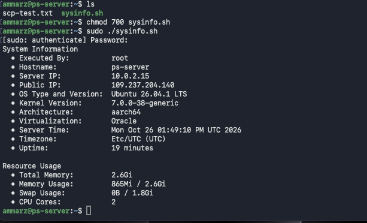
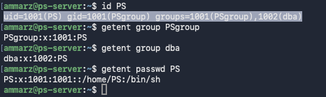
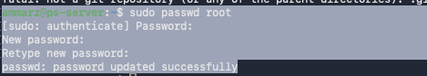
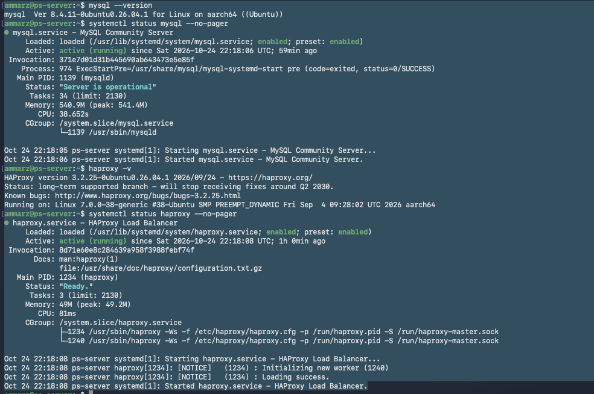
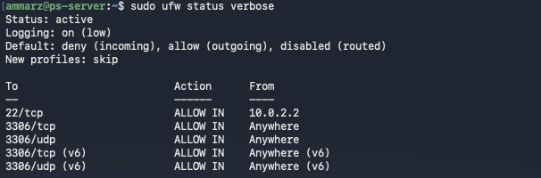

### Directory structure
Everything starts at `/`, one single tree. Disks and devices are attached into that tree instead of getting drive letters. The layout follows the **Filesystem Hierarchy Standard (FHS)**, so the same paths mean the same thing on every distribution.
# Linux

| | |
|---|---|
| Host | MacBook (Apple Silicon), VirtualBox |
| Server | `ps-server`, Ubuntu 26.04.1 LTS, ARM64 (`aarch64`), NAT network |
| Access | SSH from the Mac through a VirtualBox port forward: `ssh -p 2222 ammarz@127.0.0.1` |
| Admin user | `ammarz` (sudo) |

**Contents**
1. [System information script](#task-1-system-information-script)
2. [User and groups](#task-2-user-and-groups)
3. [Root password](#task-3-root-password)
4. [MySQL and HAProxy](#task-4-mysql-and-haproxy)
5. [Firewall: port 3306 only](#task-5-firewall-port-3306-only)
6. [Copying files from the Mac to the VM](#task-6-copying-files-from-the-mac-to-the-vm)
7. [Linux in general](#task-7-linux-in-general)

---

## Task 1: System information script

**Script:** [`sysinfo.sh`](sysinfo.sh)

**Commands**
```bash
chmod +x sysinfo.sh
sudo ./sysinfo.sh
```

| Field | Command |
|---|---|
| Executed By | `whoami` |
| Hostname | `hostname` |
| Server IP | `hostname -I \| awk '{print $1}'` |
| Public IP | `curl -4 -sf --max-time 5 ifconfig.me` |
| OS Type and Version | `grep PRETTY_NAME /etc/os-release \| cut -d'"' -f2` |
| Kernel Version | `uname -r` |
| Architecture | `uname -m` |
| Virtualization | `systemd-detect-virt`, then `lspci` |
| Server Time | `date '+%a %b %d %r %Z %Y'` |
| Timezone | `timedatectl show -p Timezone --value` and `date +%Z` |
| Uptime | `uptime -p \| cut -d' ' -f2-` |
| Total Memory | `free -h \| awk '/^Mem:/ {print $2}'` |
| Memory Usage | `free -h \| awk '/^Mem:/ {print $3 " / " $2}'` |
| Swap Usage | `free -h \| awk '/^Swap:/ {print $3 " / " $2}'` |
| CPU Cores | `nproc` |

**Result**

**TODO:** run `sudo ./sysinfo.sh` on ps-server, save the screenshot as `screenshots/T1-Linux.png`, then delete this line.



---

## Task 2: User and groups

**Commands**
```bash
sudo groupadd PSgroup
sudo groupadd dba
sudo useradd -g PSgroup -G dba PS
sudo passwd PS
```

**Result**
```text
$ id PS
uid=1001(PS) gid=1001(PSgroup) groups=1001(PSgroup),1002(dba)
$ getent group PSgroup
PSgroup:x:1001:PS
$ getent group dba
dba:x:1002:PS
$ getent passwd PS
PS:x:1001:1001::/home/PS:/bin/sh
```


---

## Task 3: Root password

**Commands**
```bash
sudo passwd root
```

**Result**
```text
ammarz@ps-server:~$ sudo passwd root
New password:
Retype new password:
passwd: password updated successfully
```


---

## Task 4: MySQL and HAProxy

**Commands**
```bash
sudo apt update
sudo apt install -y mysql-server haproxy
sudo mysql_secure_installation

mysql --version
systemctl status mysql --no-pager
haproxy -v
systemctl status haproxy --no-pager

sudo mysql -e "SELECT user, host, plugin FROM mysql.user;"
```

**Result**
- MySQL `8.4.11-0ubuntu0.26.04.1` (aarch64): `active (running)`, status `Server is operational`
- HAProxy `3.2.25-0ubuntu0.26.04.1`: `active (running)`, status `Ready.`



| `mysql_secure_installation` prompt | Answer |
|---|---|
| Password validation component | Yes, level 2 (STRONG) |
| Root password | Skipped by MySQL (root uses `auth_socket`) |
| Remove anonymous users | Yes |
| Disallow root login remotely | Skipped |
| Remove test database | Yes |
| Reload privilege tables | Yes |

**TODO:** paste the output of the `mysql.user` query here as a `text` block, then delete this line.

---

## Task 5: Firewall: port 3306 only

**Commands**
```bash
sudo ufw default deny incoming
sudo ufw default allow outgoing
sudo ufw allow 3306/tcp
sudo ufw allow 3306/udp
sudo ufw allow from 10.0.2.2 to any port 22 proto tcp     # keep SSH from my Mac only
sudo ufw enable
sudo ufw status verbose
```

**Result**
```text
Status: active
Logging: on (low)
Default: deny (incoming), allow (outgoing), disabled (routed)
New profiles: skip

To                         Action      From
--                         ------      ----
22/tcp                     ALLOW IN    10.0.2.2
3306/tcp                   ALLOW IN    Anywhere
3306/udp                   ALLOW IN    Anywhere
3306/tcp (v6)              ALLOW IN    Anywhere (v6)
3306/udp (v6)              ALLOW IN    Anywhere (v6)
```


---

## Task 6: Copying files from the Mac to the VM

**Commands**
```bash
# On my Mac, I created a test file and recorded its SHA-256 fingerprint
mkdir -p ~/ps-transfer && cd ~/ps-transfer
echo "Transfer test from my Mac $(date)" > test.txt
shasum -a 256 test.txt

# 1. scp: I copied the file in one command
scp -P 2222 test.txt ammarz@127.0.0.1:/home/ammarz/scp-test.txt

# 2. sftp: I copied the file in an interactive session
sftp -P 2222 ammarz@127.0.0.1
sftp> put test.txt sftp-test.txt
sftp> bye

# On the VM, I compared the fingerprints with the one from my Mac
sha256sum ~/*-test.txt
```

**Result**
```text
macbook@Dev-X-M5 ps-transfer % shasum -a 256 test.txt
cc2ffaa5c82a540ab34d91889305f7bf6f51f677ab9ec0d5997ffc296c022ae9  test.txt

ammarz@ps-server:~$ sha256sum ~/*-test.txt
cc2ffaa5c82a540ab34d91889305f7bf6f51f677ab9ec0d5997ffc296c022ae9  /home/ammarz/scp-test.txt
```

**TODO:** run `sha256sum ~/*-test.txt` again after the sftp copy, paste the `sftp-test.txt` line above, save the screenshot as `screenshots/T6-Linux.png`, then delete this line.


**Other options**
```bash
# rsync over SSH
rsync -avz -e "ssh -p 2222" test.txt ammarz@127.0.0.1:/home/ammarz/

# GUI client (Cyberduck or FileZilla): SFTP, host 127.0.0.1, port 2222, user ammarz

# Pull over HTTP: on my Mac, then on the VM
python3 -m http.server 8000 --bind 127.0.0.1
curl -fo ~/http-test.txt http://10.0.2.2:8000/test.txt
```

---

## Task 7: Linux in general

### Architecture
Linux is split into two zones. **Kernel space** is where the kernel runs, with full access to the hardware: it schedules processes, manages memory, runs the network stack and talks to devices. **User space** is where everything else runs: the shell (Bash), commands like `ls` and `free`, and services like MySQL. Programs in user space ask the kernel for resources through **system calls**. On this server the kernel is `7.0.0-38-generic` running on an ARM64 CPU.

```text
Applications and services   (MySQL, HAProxy, my script)
Shell and utilities         (bash, ls, free, awk)
---------------------------- system calls
Kernel                      (processes, memory, network, devices)
Hardware                    (here: virtual hardware from VirtualBox)
```

### Directory structure
Everything starts at `/`, one single tree. Disks and devices are attached into that tree instead of getting drive letters. The layout follows the **Filesystem Hierarchy Standard (FHS)**, so the same paths mean the same thing on every distribution.

| Directory | Contains |
|---|---|
| `/etc` | configuration files (for example `/etc/os-release`, `/etc/passwd`) |
| `/var/log` | log files: the first place to look during an incident |
| `/home` | users' personal folders |
| `/root` | root's home folder |
| `/opt` | vendor and third-party applications |
| `/usr/bin` | most programs and commands |
| `/tmp` | temporary files |
| `/proc` | live kernel data, generated in memory (for example `/proc/meminfo`) |
| `/dev` | devices represented as files |
| `/boot` | the kernel and the bootloader files |

### Distributions
A **distribution** is the Linux kernel packaged with tools, a package manager and default settings, released and supported as one product. They come in families:

| Family | Examples | Packages | Firewall tool |
|---|---|---|---|
| Debian | Debian, Ubuntu | `apt`, `.deb` | `ufw` |
| Red Hat | RHEL, Rocky Linux, AlmaLinux, Oracle Linux | `dnf`, `.rpm` | `firewalld` |
| SUSE | SLES, openSUSE | `zypper`, `.rpm` | `firewalld` |


