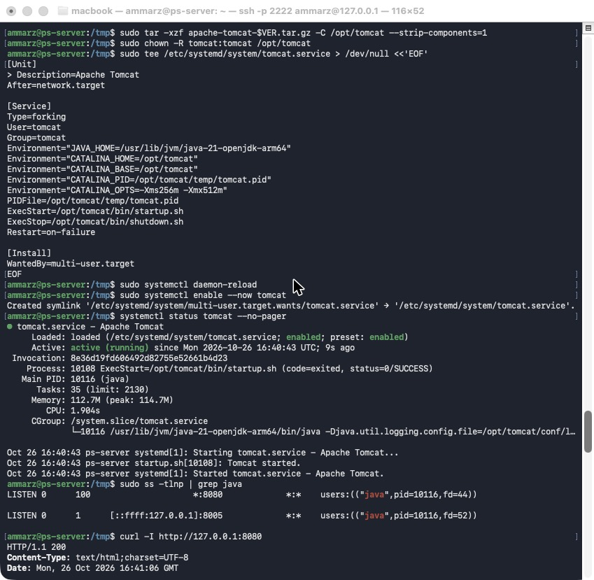
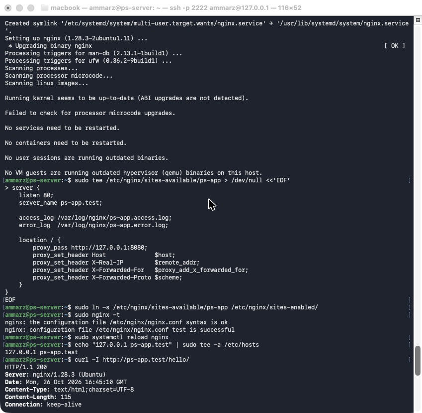
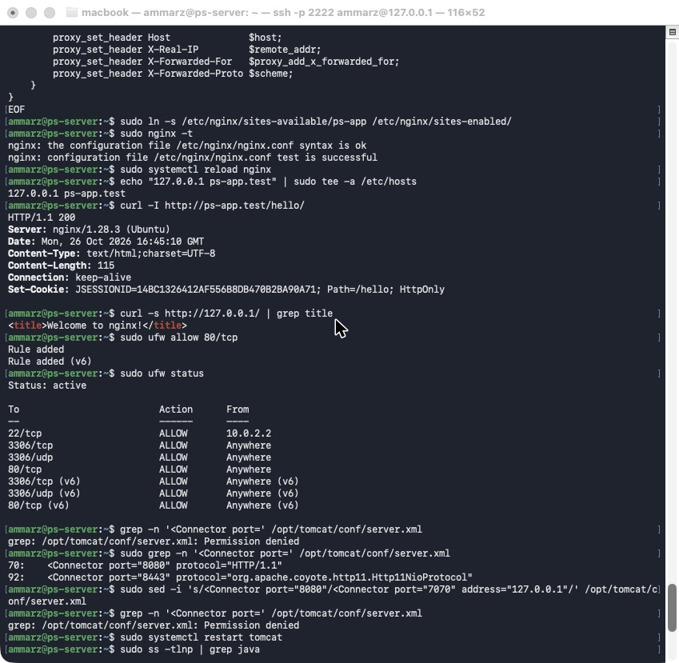
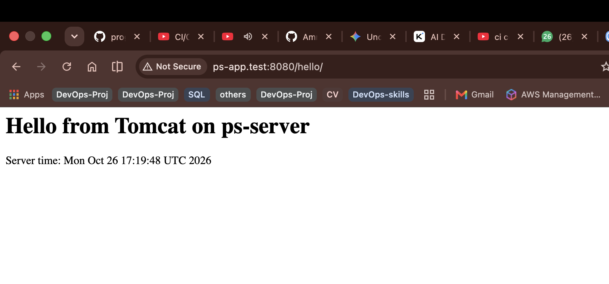
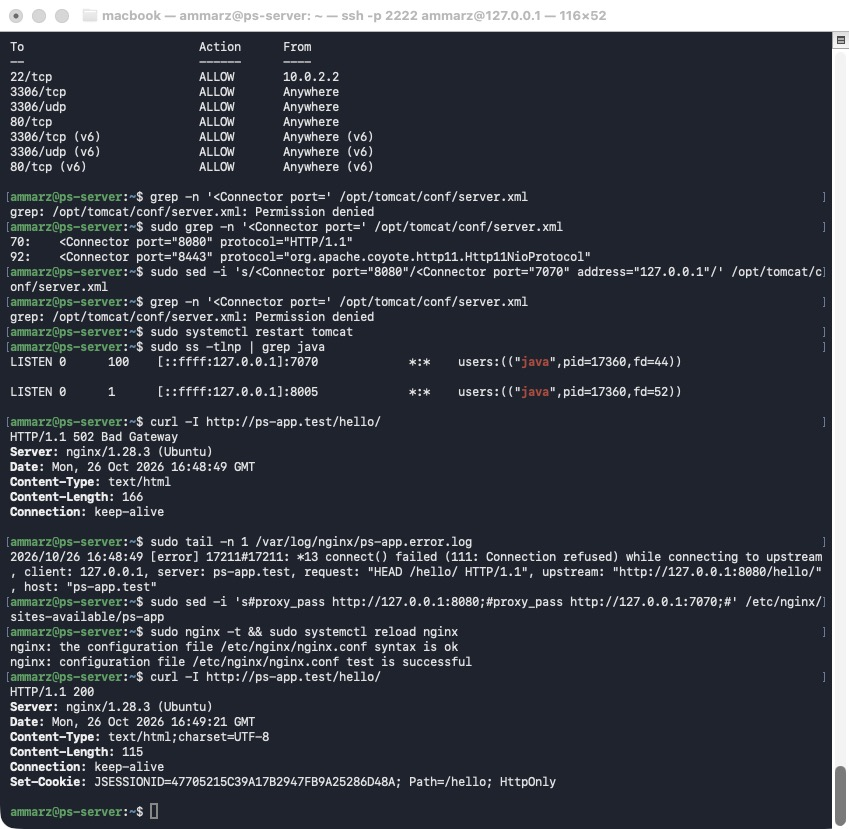
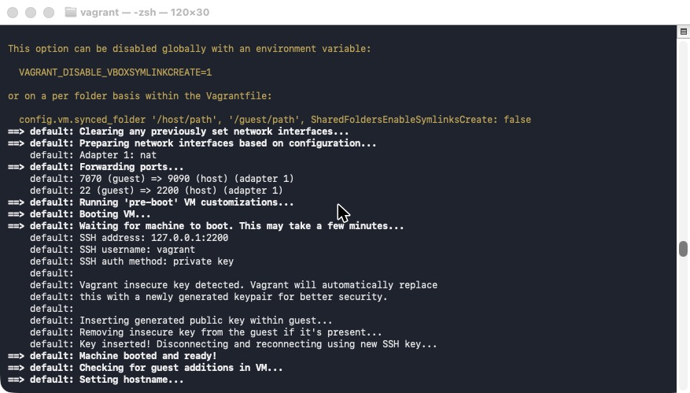
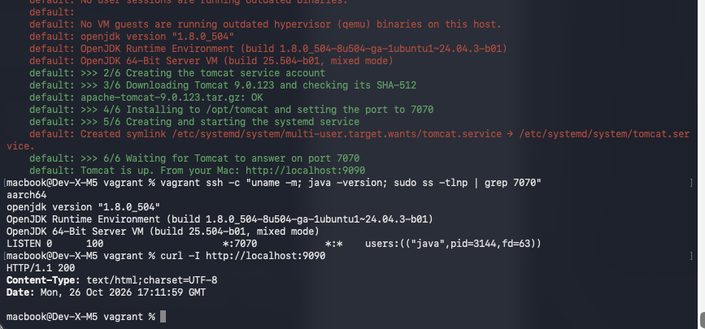

# Tomcat

| | |
|---|---|
| Server | `ps-server`, Ubuntu 26.04.1 LTS, ARM64 (`aarch64`) |
| Java | OpenJDK 21 |
| Tomcat | Apache Tomcat 10.1.61, installed in `/opt/tomcat` |
| Reverse proxy | Nginx |
| Vagrant VM | `bento/ubuntu-24.04`, Java 8, Tomcat 9.0.123 |

**Contents**
1. [What is the JVM?](#1-what-is-the-jvm)
2. [What is an application server?](#2-what-is-an-application-server)
3. [What is a WAR file?](#3-what-is-a-war-file-how-does-tomcat-handle-it-and-where-is-it-deployed)
4. [Practice 1: Tomcat behind Nginx, reached by a name on port 80](#practice-1-tomcat-behind-nginx-reached-by-a-name-on-port-80)
5. [Practice 2: Tomcat on port 7070](#practice-2-tomcat-on-port-7070)
6. [Practice 3: Vagrant](#practice-3-vagrant)

---

## Theory

### 1. What is the JVM?

-- The JVM (Java Virtual Machine) is the program that run Java applications, Java code is compiled into **bytecode**, this format can't be read by the CPU so every machine that Java application has the JVM which complied the bytecode into alanguage that CPU can understand it, also JVM manage the application's memory (**the heap**) and free memory the application no longer user


### 2. What is an application server?
-- it's a software that host applications and do the common work such as listen for request port and give each request
thread to handle with providing shared service such as Database, user session and security. 

### 3. What is a WAR file, how does Tomcat handle it, and where is it deployed?
A WAR (Web Application Archive) is a comprasied file that containe everythting java application need to run, instead of dealing with loads of file, the developer comprasized everything into one file.

-- How Tomcat handle it? 
so when tomcat get the WAR file, it will extract and get all the folders inside it, then it read the config file and setup the enviromenet to le tthe app run.

-- Where it should be deployed?
Tomcat have a specified folder insid the directory, called **webapp**, wherre i drop my WAR file, it automatacilly grab it, deploy it and let the app up and running. 
 
-- Tomcat is lighter-weight one called servlet container **web container** it implement core java web technologies like java servlet, also written in java which mean it need JVM to run. 
| Inside the WAR | Contains |
|---|---|
| `/` (top level) | pages, JSPs, CSS, images |
| `WEB-INF/web.xml` | the deployment descriptor (the app's settings) |
| `WEB-INF/classes/` | the compiled application code |
| `WEB-INF/lib/` | the libraries (`.jar` files) the app needs |
| `META-INF/` | information about the archive |

**How Tomcat handles it**
1. The WAR is copied into Tomcat's `webapps/` folder.
2. Tomcat detects the new file (`autoDeploy="true"` in `conf/server.xml`).
3. It unpacks the file into a folder with the same name (`unpackWARs="true"`).
4. The app goes live at a path named after the file: `payments.war` is served at `/payments/`. A file named `ROOT.war` is served at the root path `/`.

Replacing the WAR redeploys the app, and deleting it undeploys it.

**Where it's deployed:** in `$CATALINA_BASE/webapps`, which is `/opt/tomcat/webapps` on this server. It can also be deployed through Tomcat's Manager web application. In production, automatic deployment is usually switched off: new versions are deployed during a planned change window, and the previous WAR is kept so the change can be rolled back.

---

## Practice

### Practice 1: Tomcat behind Nginx, reached by a name on port 80

**Commands: Java, service account, Tomcat**
```bash
sudo apt update
sudo apt install -y openjdk-21-jre-headless zip unzip
sudo useradd -r -U -d /opt/tomcat -s /usr/sbin/nologin tomcat

VER=10.1.61
cd /tmp
curl -fLO https://dlcdn.apache.org/tomcat/tomcat-10/v$VER/bin/apache-tomcat-$VER.tar.gz
curl -fLO https://downloads.apache.org/tomcat/tomcat-10/v$VER/bin/apache-tomcat-$VER.tar.gz.sha512
sha512sum -c apache-tomcat-$VER.tar.gz.sha512
sudo mkdir -p /opt/tomcat
sudo tar -xzf apache-tomcat-$VER.tar.gz -C /opt/tomcat --strip-components=1
sudo chown -R tomcat:tomcat /opt/tomcat
```

**Commands: Tomcat as a systemd service**
```bash
sudo tee /etc/systemd/system/tomcat.service > /dev/null <<'EOF'
[Unit]
Description=Apache Tomcat
After=network.target

[Service]
Type=forking
User=tomcat
Group=tomcat
Environment="JAVA_HOME=/usr/lib/jvm/java-21-openjdk-arm64"
Environment="CATALINA_HOME=/opt/tomcat"
Environment="CATALINA_BASE=/opt/tomcat"
Environment="CATALINA_PID=/opt/tomcat/temp/tomcat.pid"
Environment="CATALINA_OPTS=-Xms256m -Xmx512m"
PIDFile=/opt/tomcat/temp/tomcat.pid
ExecStart=/opt/tomcat/bin/startup.sh
ExecStop=/opt/tomcat/bin/shutdown.sh
Restart=on-failure

[Install]
WantedBy=multi-user.target
EOF

sudo systemctl daemon-reload
sudo systemctl enable --now tomcat
systemctl status tomcat --no-pager
sudo ss -tlnp | grep java
curl -I http://127.0.0.1:8080
```

**Result**
```text
● tomcat.service - Apache Tomcat
     Loaded: loaded (/etc/systemd/system/tomcat.service; enabled; preset: enabled)
     Active: active (running) since Mon 2026-10-26 16:40:43 UTC; 9s ago
   Main PID: 10116 (java)

LISTEN 0      100                    *:8080      *:*    users:(("java",pid=10116,fd=44))
LISTEN 0      1      [::ffff:127.0.0.1]:8005      *:*    users:(("java",pid=10116,fd=52))

HTTP/1.1 200
Content-Type: text/html;charset=UTF-8
```


**Commands: deploy a test WAR**
```bash
mkdir -p ~/hello && cd ~/hello
cat > index.jsp <<'EOF'
<html><body><h1>Hello from Tomcat on ps-server</h1>
<p>Server time: <%= new java.util.Date() %></p></body></html>
EOF
zip -r ../hello.war . && cd ~
sudo cp hello.war /opt/tomcat/webapps/ && sudo chown tomcat:tomcat /opt/tomcat/webapps/hello.war
curl http://127.0.0.1:8080/hello/
```

**Result**
```text
<html><body><h1>Hello from Tomcat on ps-server</h1>
<p>Server time: Mon Oct 26 16:42:43 UTC 2026</p></body></html>
```

**Commands: Nginx reverse proxy and the DNS name**
```bash
sudo apt install -y nginx
sudo tee /etc/nginx/sites-available/ps-app > /dev/null <<'EOF'
server {
    listen 80;
    server_name ps-app.test;

    access_log /var/log/nginx/ps-app.access.log;
    error_log  /var/log/nginx/ps-app.error.log;

    location / {
        proxy_pass http://127.0.0.1:8080;
        proxy_set_header Host              $host;
        proxy_set_header X-Real-IP         $remote_addr;
        proxy_set_header X-Forwarded-For   $proxy_add_x_forwarded_for;
        proxy_set_header X-Forwarded-Proto $scheme;
    }
}
EOF
sudo ln -s /etc/nginx/sites-available/ps-app /etc/nginx/sites-enabled/
sudo nginx -t
sudo systemctl reload nginx
echo "127.0.0.1 ps-app.test" | sudo tee -a /etc/hosts
curl -I http://ps-app.test/hello/
curl -s http://127.0.0.1/ | grep title
```

**Result**
```text
nginx: the configuration file /etc/nginx/nginx.conf syntax is ok
nginx: configuration file /etc/nginx/nginx.conf test is successful

HTTP/1.1 200
Server: nginx/1.28.3 (Ubuntu)
Content-Type: text/html;charset=UTF-8

<title>Welcome to nginx!</title>
```


**Commands: open port 80 and reach the app from the Mac**
```bash
# On ps-server
sudo ufw allow 80/tcp
sudo ufw status

# On the Mac: forward Mac port 8080 to the VM's port 80, then add the name
VBoxManage controlvm "ps-server" natpf1 "http,tcp,127.0.0.1,8080,,80"
echo "127.0.0.1 ps-app.test" | sudo tee -a /etc/hosts
curl -I http://ps-app.test:8080/hello/
```

**Result**
```text
Status: active

To                         Action      From
--                         ------      ----
22/tcp                     ALLOW       10.0.2.2
3306/tcp                   ALLOW       Anywhere
3306/udp                   ALLOW       Anywhere
80/tcp                     ALLOW       Anywhere
3306/tcp (v6)              ALLOW       Anywhere (v6)
3306/udp (v6)              ALLOW       Anywhere (v6)
80/tcp (v6)                ALLOW       Anywhere (v6)
```




---

### Practice 2: Tomcat on port 7070

**Commands**
```bash
sudo grep -n '<Connector port=' /opt/tomcat/conf/server.xml
sudo sed -i 's/<Connector port="8080"/<Connector port="7070" address="127.0.0.1"/' /opt/tomcat/conf/server.xml
sudo systemctl restart tomcat
sudo ss -tlnp | grep java

# Nginx still points at 8080
curl -I http://ps-app.test/hello/
sudo tail -n 1 /var/log/nginx/ps-app.error.log

# Point Nginx at 7070
sudo sed -i 's#proxy_pass http://127.0.0.1:8080;#proxy_pass http://127.0.0.1:7070;#' /etc/nginx/sites-available/ps-app
sudo nginx -t && sudo systemctl reload nginx
curl -I http://ps-app.test/hello/
```

**Result**
```text
70:    <Connector port="8080" protocol="HTTP/1.1"

LISTEN 0      100    [::ffff:127.0.0.1]:7070      *:*    users:(("java",pid=17360,fd=44))
LISTEN 0      1      [::ffff:127.0.0.1]:8005      *:*    users:(("java",pid=17360,fd=52))

HTTP/1.1 502 Bad Gateway
Server: nginx/1.28.3 (Ubuntu)

2026/10/26 16:48:49 [error] 17211#17211: *13 connect() failed (111: Connection refused) while connecting to upstream, client: 127.0.0.1, server: ps-app.test, request: "HEAD /hello/ HTTP/1.1", upstream: "http://127.0.0.1:8080/hello/", host: "ps-app.test"

nginx: the configuration file /etc/nginx/nginx.conf syntax is ok
nginx: configuration file /etc/nginx/nginx.conf test is successful

HTTP/1.1 200
Server: nginx/1.28.3 (Ubuntu)
Content-Type: text/html;charset=UTF-8
```


---

### Practice 3: Vagrant

**Files**
- [`vagrant/Vagrantfile`](vagrant/Vagrantfile): `bento/ubuntu-24.04`, guest port 7070 forwarded to host port 9090, 2 GB of memory
- [`vagrant/provision/install-tomcat9.sh`](vagrant/provision/install-tomcat9.sh): installs Java 8 and Tomcat 9.0.123 on port 7070 as a systemd service
- [`vagrant/port_check_patch.rb`](vagrant/port_check_patch.rb): fixes a Vagrant 2.4.9 bug on macOS 26.7+ that reports every forwarded port as already in use ([hashicorp/vagrant#13845](https://github.com/hashicorp/vagrant/issues/13845))

**Commands**
```bash
cd tomcat/vagrant
vagrant validate
vagrant up
vagrant ssh -c "uname -m; java -version; sudo ss -tlnp | grep 7070"
curl -I http://localhost:9090
```

**Result**
```text
==> default: Forwarding ports...
    default: 7070 (guest) => 9090 (host) (adapter 1)

    default: >>> 3/6 Downloading Tomcat 9.0.123 and checking its SHA-512
    default: apache-tomcat-9.0.123.tar.gz: OK
    default: >>> 4/6 Installing to /opt/tomcat and setting the port to 7070
    default: >>> 5/6 Creating and starting the systemd service
    default: >>> 6/6 Waiting for Tomcat to answer on port 7070
    default: Tomcat is up. From your Mac: http://localhost:9090

aarch64
openjdk version "1.8.0_504"
OpenJDK Runtime Environment (build 1.8.0_504-8u504-ga-1ubuntu1~24.04.3-b01)
OpenJDK 64-Bit Server VM (build 25.504-b01, mixed mode)
LISTEN 0      100                *:7070            *:*    users:(("java",pid=3144,fd=63))

HTTP/1.1 200
Content-Type: text/html;charset=UTF-8
```



